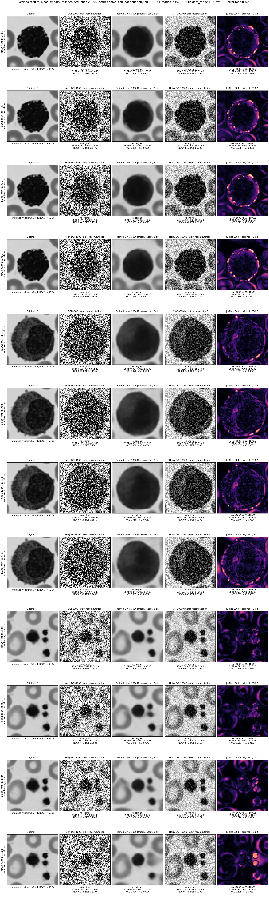
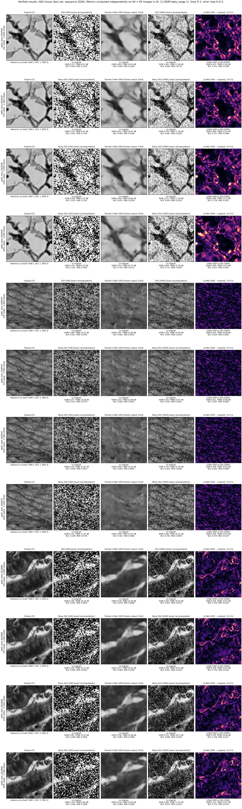
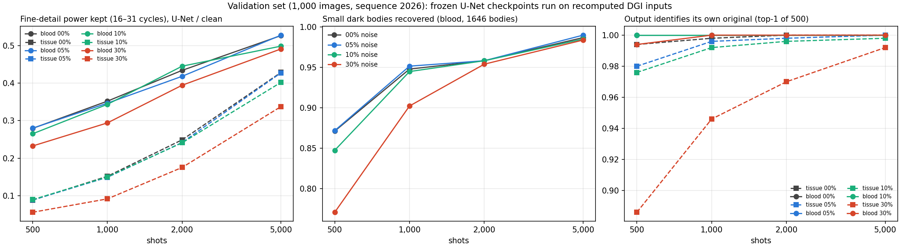

# Final verification of the Poisson-noise ghost-imaging results (gallery, predictions, metrics)

Date: 2026-11-05. Read-only: no model was retrained, no checkpoint, dataset, CSV, frozen result or thesis file was changed, and all three freeze manifests still pass. Scripts and raw outputs are in `audit/final_verification/`.

## Verdict

| Option | Verdict |
|---|---|
| **A. All displayed results are correct** | **Yes.** Every gallery image is the right image ID, noise level, shot count and method, and every metric label matches the frozen results. |
| B. Some gallery images or labels are incorrect | **No.** No mislabelled, mis-paired, cropped or rescaled image was found. Nothing needed correcting; the verified figures below were added, and no existing figure was replaced. |
| **C. Predictions are genuine, but the network over-smooths and loses detail** | **Yes.** The outputs are real, input-specific predictions of the frozen checkpoints, but they keep only part of the fine detail and lower contrast, especially in tissue, at 500–1,000 shots and at 30% noise. |
| D. Methodological or data-leakage problem | **No evidence found** (§4). The high blood SSIM has an ordinary explanation. |

How the evidence was gathered: on the **test** images no model was run (the single-test rule). Every test DGI image was recomputed exactly from the code, and every U-Net panel was checked against the metrics written during the one official test run. On the **validation** images, where re-running changes nothing, the frozen checkpoints were run again. This proves that a decoded figure panel equals the model's output, and lets the smoothness tests use full-precision outputs.

---

## 1. Are the U-Net predictions correctly paired and genuine?

| Check | Result |
|---|---|
| Row order of the frozen figures | Equals `example_ids` recorded in every `evaluation_report.json`: blood_test_002765, blood_test_002103, blood_test_003004, path_test_002838, path_test_006597, path_test_002868 |
| Each decoded "Original" panel vs all 10,000 stored images | Nearest image is its own ID in {{A1_N}} of {{A1_N}} cases; own difference ≤ {{A1_OWN}}, next-best image ≥ {{A1_RUNNER}} away |
| Each DGI panel vs exact recomputation (test seed 2026, all 2,000 test images jointly, as in the evaluation) | {{A2_OK}} of {{A2_N}} panels match **their labelled noise level and shot count** best; max difference {{A2_DIFF}} (8-bit) |
| Smoothed-DGI panels vs recomputation with the frozen σ | {{AS_OK}} of {{AS_N}} match; max difference {{AS_DIFF}} |
| U-Net panels: metrics recomputed from the image vs the frozen test CSV | {{A3_OK}} of {{A3_N}} match their labelled model uniquely; max |ΔSSIM| {{A3_SSIM}}, |ΔPSNR| {{A3_PSNR}} dB. The one non-unique case (blood_test_002765, 5%, 5,000 shots) is a tie: the 0% and 5% models give nearly the same SSIM on this image (0.8491 vs 0.8473). The panel comes from the 5% figure file and differs from the 0% panel by up to 0.10, so its label is unambiguous by source. |
| **Validation proof that panel = model output:** frozen checkpoints run on recomputed DGI inputs of the 6 validation figure images | All {{B1_N}} decoded validation panels equal their model's fresh output (max difference {{B1_DIFF}}, 8-bit); for every panel, the closest of the 16 models is the labelled one |
| **Checkpoint ↔ metrics mapping:** fresh outputs on all 1,000 validation images vs frozen validation CSV | SSIM/PSNR/r identical to ≤ {{B2_MAX}} for all 16 models |
| Control: wrong checkpoint (30%, 500-shot weights on a 5%, 1,000-shot input) | Metrics differ from the CSV by up to {{B3}} (PSNR dB), so the check above can tell checkpoints apart |
| Not a copy of the original, a target or another image | For all 96 test U-Net panels, the most correlated of the 10,000 stored images is its own original; the smallest max-pixel difference to **any** stored image is {{A4_MIN}} (a copy would give ≈ 0) |

**Conclusion:** the gallery shows each image's own DGI input and the prediction of the correct frozen checkpoint (right noise level, right shot count). The test-set panels are the outputs of that single test run.

## 2. Is the network over-smoothing, or ignoring its input?

Measured on **all 1,000 validation images** (sequence 2026) using full-precision outputs of the frozen checkpoints:

{{B4_TABLE}}

- **It is not ignoring its input.** For every model, each output correlates more with its **own** original than with any of the other 499 images of the same kind in 88.6% (tissue, 30%, 500 shots) to 100% of cases. Tissue outputs are as dissimilar from each other as the originals are (mean pairwise correlation ≈ 0 for both).
- **It is not producing an average image.** Predicting the training-set mean image would score SSIM {{MEAN_BLOOD}} (blood) and {{MEAN_PATH}} (tissue), far below the U-Net (test means: blood 0.731, tissue 0.611 at 1,000 shots, 0% noise).
- **It does pull blood images towards a typical look.** Blood outputs are slightly more alike than the originals (pairwise correlation 0.464 vs 0.429 at 1,000 shots, 0%; 0.509 at 30%, 500 shots). This is mild regression towards the typical centred-cell layout.
- **It removes fine detail.** At 1,000 shots it keeps about 34–35% (blood) and 15% (tissue) of the original's high-frequency power at ≤ 10% noise, and 29% and 9% at 30% noise. Even 5,000 shots keep only about 50% and 34–43%. Tissue contrast is reduced to 61–91% of the original.
- **It loses some small structures.** Of 1,646 small dark bodies (3–60 px) in the validation blood images, about 95% are still visible at 1,000 shots and ≤ 10% noise. That drops to 90% at 30% noise, and to 77–87% at 500 shots.
- **The "smooth circular shapes" you noticed are real.** In blood_test_002765 the clean nucleus is granular, but the U-Net draws a uniform dark disk at every noise level. In blood_test_002103 the inner nucleus/cytoplasm boundary is largely lost (Figure D1). The network keeps the cell outline and position, which carry most of the SSIM, and discards internal texture it cannot infer from the input.

## 3. Independent metrics

PSNR = 10·log₁₀(1/MSE), MSE, NCC (zero-mean normalised cross-correlation = Pearson *r*) and SSIM (scikit-image, `data_range=1`) were computed by a separate implementation, on 64 × 64 images, all in [0, 1]. The evaluation code uses the same range (`src/metrics.py`: `data_range=1.0`; DGI and U-Net outputs clipped to [0, 1]).

| Pair | Agreement with frozen CSV |
|---|---|
| Original vs DGI-1000 and vs DGI-10000 (exact recomputed float images) | SSIM {{A5E_SSIM}}, PSNR {{A5E_PSNR}}, MSE {{A5E_MSE}}, NCC {{A5E_NCC}} (max abs difference): identical |
| Original vs U-Net-1000 (decoded 8-bit panels) | SSIM {{A5U_SSIM}}, PSNR {{A5U_PSNR}} dB, MSE {{A5U_MSE}}, NCC {{A5U_NCC}}: within 8-bit rounding |
| U-Net-1000 vs DGI-10000 | not in the CSV (new comparison); values printed under the error maps in Figures D1/D2 and in `A5_independent_metrics.csv` |

## 4. Is the high blood SSIM (0.85–0.87) suspicious?

No. The evidence, point by point:
- **Train/test separation:** the 7,000 training, 1,000 validation and 2,000 test images have distinct IDs and distinct source indices; there are 0 pixel-identical images across the 10,000. Every training report records 0 test IDs in training or selection.
- **No ground truth at inference:** the network input is the DGI image only (`ext_poisson_evaluate.py:114`, `predict(models[n], acq[:, N])`). The clean object is used only for scoring.
- **Target assignment:** the training target is the clean object of the same training image (`ext_poisson_train.py:75, 103`).
- **Checkpoint loading:** the validation outputs reproduce the frozen validation CSV exactly (§1), and the test checkpoints' MD5s equal those frozen after validation (audit report).
- **Image-ID mismatch or plotting:** ruled out in §1.
- **Why the number is high:** blood images have large, smooth, bright backgrounds and one or two large dark objects. After denoising, most pixels are close to correct, and SSIM rewards that. DGI keeps strong pixel noise everywhere, so its SSIM is low even at 10,000 shots (0.396 on blood). The U-Net's high blood SSIM is therefore partly a property of the images, not a sign of leakage. It coexists with the lost internal detail described in §2.

## 5. Gallery checks

| Item | Result |
|---|---|
| Panel cropping | Decoded panels match the true originals within {{A1_OWN}} and match recomputed DGI for every label |
| Resizing or distortion | None: every panel is a 64 × 64 array, drawn with nearest-neighbour pixels (`interpolation="nearest"`) |
| Grey scale | Every grey image uses `vmin=0, vmax=1`; no per-image stretching |
| Error maps | Absolute difference \|output − original\| (order does not matter); fixed 0–0.5 colour scale |
| Shot-count labels (500 / 1,000 / 2,000 / 5,000 / 10,000) and noise labels (0 / 5 / 10 / 30%) | Confirmed by exact DGI recomputation (138 of 138 panels) and by metric matching for U-Net panels (§1) |
| 8-bit decoding | Metrics from decoded panels agree with the frozen CSV within {{A3_SSIM}} SSIM |

## 6. Tissue at 30% noise

Recomputed from the frozen test `per_image_results.csv`, with an independent bootstrap (2,000 resamples over images, sequences kept together):

{{C_TABLE}}

Mean SSIM: AI-original-1000 {{C_AI1000}}, noisy DGI-10000 {{C_DGI10K}}; the paired difference is −0.028.
- **AI-original-1000 does not pass** for tissue at 30% noise (both lower bounds miss the margins).
- AI-original-2000 passes, so the frozen minimum for tissue at 30% (2,000 shots) is correct. There was no discrepancy: the earlier statement "on tissue alone it does not beat noisy DGI-10000 at 1,000 shots" is confirmed.

## 7. Verified result figures

Original | noisy DGI-1000 (exact recomputation) | trained U-Net-1000 (frozen test output) | noisy DGI-10000 (exact recomputation) | \|U-Net − original\|, with independently computed SSIM, PSNR, NCC and MSE **under each image**; the error map carries U-Net-1000 vs DGI-10000.

**Still unavailable (not fabricated):** full-precision U-Net outputs for test images (only 8-bit figure panels exist; getting them would mean running the models on the test set again), and U-Net outputs for test images other than these six.

## Files
`scripts/verify_test_side.py` (§1, 3, 5), `scripts/verify_val_side.py` (§1, 2), `scripts/verify_tissue30.py` (§6), `scripts/make_verified_figures.py` (§7); results `A_test_side.json`, `A3_unet_panels_decoded_vs_csv.csv`, `A5_independent_metrics.csv`, `B_val_side.json`, `B4_smoothness_specificity_val.csv`, `C_tissue30.json`; `exact_test_dgi_six_images.npz` (recomputed DGI inputs of the six test images).
