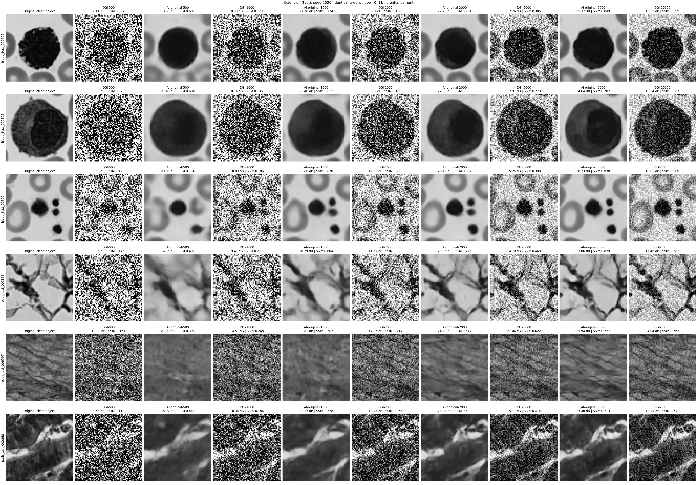
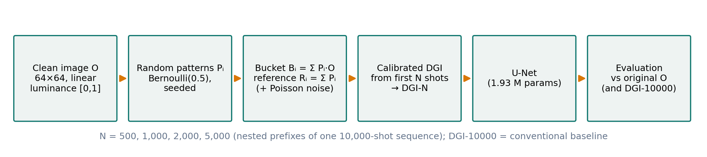
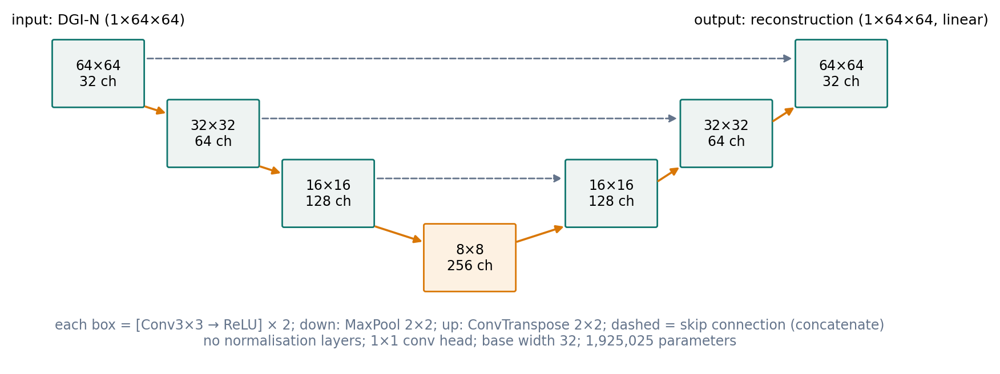
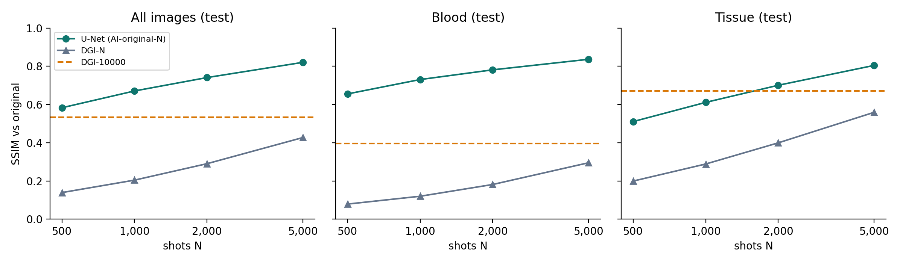
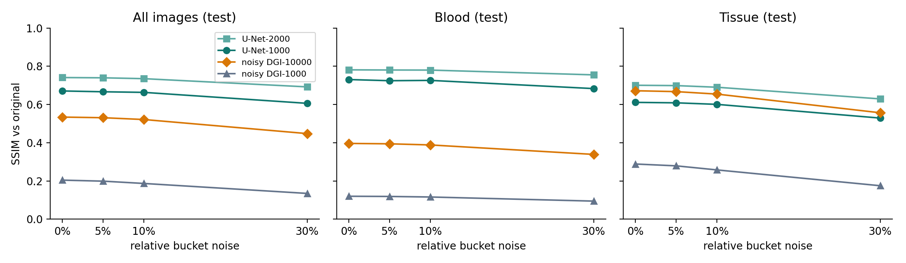
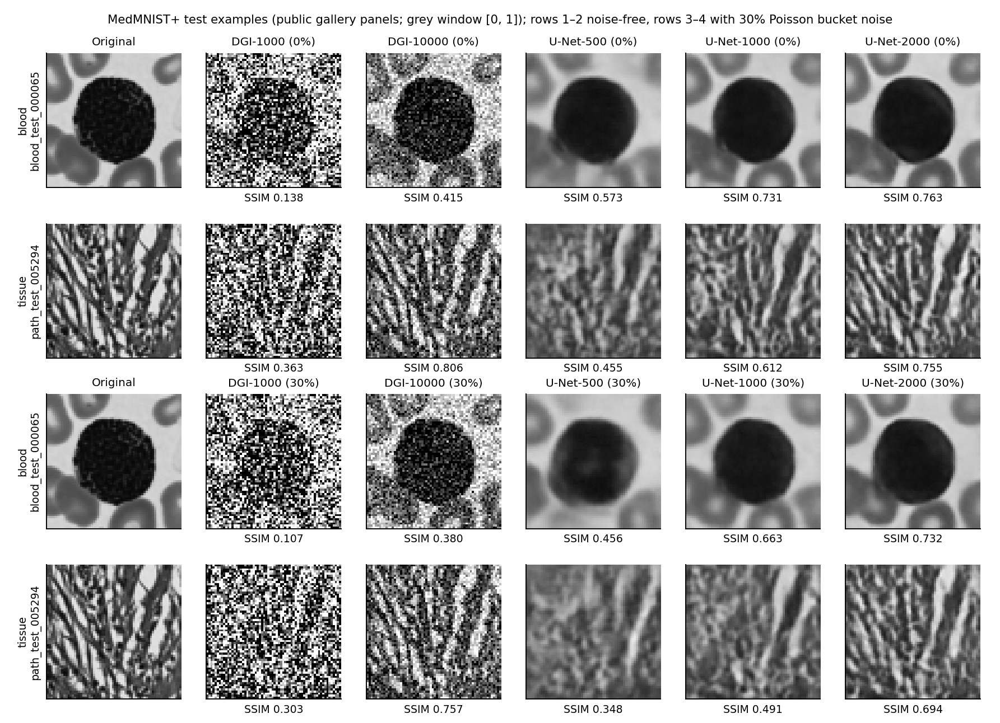
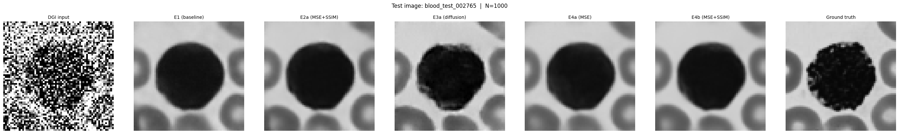
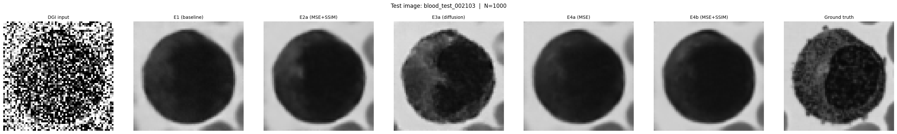
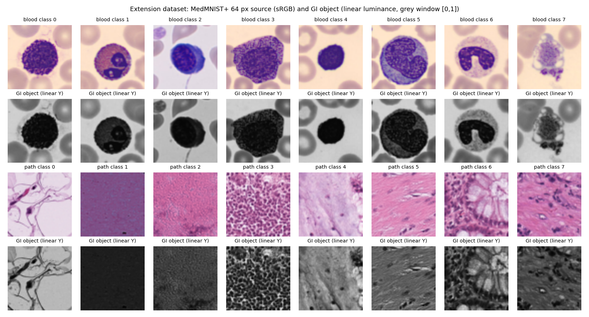

<div align="center">

# Low-Shot Computational Ghost Imaging via DiffTransFuse

**Reconstructing microscopy images from as few as 500 single-pixel measurements using deep learning**

[](#requirements)
[](#requirements)
[](#license)
[](#data-attribution)

**Team:** B23147 / B23139 / B23235  
**Guide:** Amit Dattatraya Lad, CQST, IIT Mandi

</div>

---

<p align="center">
  
</p>
<p align="center"><em>
  U-Net reconstruction quality on held-out MedMNIST+ test images. Each row shows a different microscopy sample (blood cells, tissue).
  Columns compare the original target, DGI reconstructions at N = 500–5000 shots, the corresponding U-Net outputs, and a 10,000-shot DGI reference.
  The U-Net at 1,000 shots matches or exceeds conventional DGI at 10,000 shots — a 10× measurement reduction.
</em></p>

---

## Overview

Computational Ghost Imaging (CGI) reconstructs an image from single-pixel bucket measurements taken under known illumination patterns. Conventional approaches (DGI) need thousands of measurements for acceptable quality. This project develops deep-learning methods that achieve high-fidelity reconstructions from **500–5,000 shots** — a 10–20× reduction in acquisition time.

We present a progressive experiment chain spanning two stages:

| Stage | Directory | What it does |
|-------|-----------|-------------|
| **Stage 1** — U-Net Baseline (E1) | [`01_UNet_Baseline/`](01_UNet_Baseline/) | Supervised U-Net mapping DGI → clean object; tested on onion cells, MedMNIST+ microscopy, and Poisson-noise conditions |
| **Stage 2** — DiffTransFuse (E2–E4) | [`02_DiffTransFuse/`](02_DiffTransFuse/) | Loss ablation → diffusion U-Net → TransFusionNet, achieving state-of-the-art quality with 61.7× speedup over diffusion |

---

## Pipeline

<p align="center">
  
</p>
<p align="center"><em>
  Simulation pipeline: a 64×64 object is illuminated by Bernoulli(0.5) binary patterns.
  Each pattern produces one scalar bucket measurement. After N shots, calibrated DGI yields
  a noisy reconstruction that serves as input to the neural network.
</em></p>

### How it works

1. **Pattern generation:** Binary Bernoulli(0.5) illumination patterns, 64 × 64 pixels
2. **Measurement:** Each pattern produces a single scalar bucket value (inner product of pattern × object)
3. **DGI reconstruction:** Calibrated Differential Ghost Imaging from N shots, clipped to [0, 1]
4. **Neural network:** The DGI image is fed to a trained model that outputs a clean reconstruction

Shot counts **N ∈ {500, 1000, 2000, 5000}** are nested prefixes of a single 10,000-shot sequence, so comparisons across N use exactly the same initial measurements.

---

## Experiments

### E1 — U-Net Baseline

<p align="center">
  
</p>

A standard U-Net (1,925,025 parameters, base channels = 32) trained with MSE loss to map DGI-N → clean target.

**Three experimental settings:**

| Setting | Data | Key finding |
|---------|------|-------------|
| **Onion study** | 341/75/74 onion micrographs (train/val/test) | U-Net at 1,000 shots matches independent 10,000-shot DGI (10× reduction) |
| **MedMNIST+ extension** | 10,000 blood + tissue images (7,000/1,000/2,000 split) | U-Net passes at 1,000 shots on combined data; blood passes at 500 shots |
| **Poisson noise sweep** | Same images, bucket noise at f = 5%, 10%, 30% | U-Net passes at 1,000 shots at all noise levels (combined data) |

<details>
<summary><strong>SSIM vs shot count — noise-free extension</strong></summary>
<p align="center">
  
</p>
<p><em>Three panels: all images, blood only, tissue only. U-Net (green) surpasses the DGI-10,000 baseline (dashed) at ~1,000 shots.</em></p>
</details>

<details>
<summary><strong>SSIM vs shot count — Poisson noise</strong></summary>
<p align="center">
  
</p>
<p><em>Noise levels f = 5%, 10%, 30%. The U-Net is robust to moderate bucket noise, maintaining its advantage over DGI at all tested levels.</em></p>
</details>

<details>
<summary><strong>Reconstruction examples with noise</strong></summary>
<p align="center">
  
</p>
<p><em>Blood and tissue reconstructions under noise-free and 30% Poisson noise conditions, with per-image SSIM values.</em></p>
</details>

**Pass rule (fixed before training):** paired 95% bootstrap CI (2,000 resamples) ≥ −0.02 SSIM **and** ≥ −0.01 Pearson r.

### E2 — Loss Ablation

U-Net architecture identical to E1, trained with three loss functions:

| Variant | Loss | Purpose |
|---------|------|---------|
| E2a | MSE + SSIM | Structural similarity regularization |
| E2b | MSE + edge (Sobel) | Edge-preservation regularization |
| E2c | MSE + SSIM + edge | Combined |

E2a (MSE + SSIM) showed the most consistent improvement and was carried forward.

### E3 — Residual Diffusion U-Net

A diffusion U-Net trained with ε-prediction on the residual (object − DGI). Sampling uses 100-step DDIM. E3 learns rich multi-scale features but suffers from:
- 2–3 dB PSNR deficit vs E1 (the iterative denoiser over-smooths)
- 275 ms per image (vs 1.1 ms for E1)

E3's value is as a **feature extractor** for Stage 2, not as a standalone reconstructor.

### E4 — TransFusionNet (DiffTransFuse Stage 2)

The core contribution. TransFusionNet replaces E3's iterative DDIM sampling with a **single forward pass** through a Transformer-augmented decoder:

```
Frozen E3 Encoder (3.0M params)         ← pretrained diffusion features
         ↓
Bottleneck Transformer                   ← 4 layers, 4 heads, 64 tokens (8×8)
         ↓
CNN Decoder + Channel-Attention Fusion   ← skip connections from encoder + DGI at every scale
         ↓
Reconstructed object (64×64)
```

| Component | Parameters |
|-----------|-----------|
| Frozen E3 encoder | 2,999,393 |
| Transformer (4 layers, 4 heads) | ~3,175,000 |
| CNN decoder + channel attention | ~1,285,000 |
| **Total trainable** | **4,460,097** |

Two variants: **E4a** (MSE loss) optimizes PSNR; **E4b** (MSE + 0.1×SSIM loss) optimizes SSIM.

<p align="center">
  
</p>
<p align="center">
  
</p>
<p align="center"><em>
  Reconstruction comparison at N = 1,000 shots. Left to right: DGI → E1 → E2a → E3a → E4a → E4b → ground truth.
  E4 variants recover detail that DGI and E3 miss, matching or exceeding the E1 baseline.
</em></p>

---

## Results

All results below are on the **held-out test set** (2,000 images × 3 seeds = 6,000 samples), never used for training or model selection.

### PSNR (dB) — higher is better

| N | DGI | E1 | E2a | E3a | **E4a** | E4b |
|------|-------|-------|-------|-------|---------|---------|
| 500 | 9.99 | 21.21 | 21.13 | 18.49 | **21.35** | 21.31 |
| 1000 | 11.66 | 22.80 | 22.71 | 20.05 | **22.85** | 22.79 |
| 2000 | 13.76 | 24.45 | 24.41 | 22.13 | **24.60** | 24.50 |
| 5000 | 17.03 | 26.65 | 26.56 | 24.45 | **26.78** | 26.59 |

**E4a achieves the highest PSNR at all four shot counts.**

### SSIM — higher is better

| N | DGI | E1 | E2a | E3a | E4a | **E4b** |
|------|-------|-------|-------|-------|-------|---------|
| 500 | 0.139 | 0.579 | 0.605 | 0.484 | 0.592 | **0.612** |
| 1000 | 0.204 | 0.669 | 0.686 | 0.571 | 0.678 | **0.692** |
| 2000 | 0.291 | 0.741 | 0.755 | 0.662 | 0.748 | **0.759** |
| 5000 | 0.428 | 0.820 | 0.826 | 0.759 | 0.823 | **0.830** |

**E4b achieves the highest SSIM at all four shot counts.**

### Inference Latency

| Method | Latency (ms) | Speedup vs E3 |
|--------|-------------|---------------|
| E1 (U-Net) | 1.1 | 250× |
| E3a (DDIM, 100 steps) | 275.3 | 1× |
| **E4a / E4b (single pass)** | **4.5** | **61.7×** |

### Statistical Significance

Paired image-level bootstrap 95% CIs (2,000 resamples, clustered by image):

| Comparison | Metric | N = 500 | N = 1000 | N = 2000 | N = 5000 |
|------------|--------|---------|----------|----------|----------|
| E4a − E1 | PSNR | +0.14 dB ✓ | +0.05 dB ✓ | +0.15 dB ✓ | +0.13 dB ✓ |
| E4b − E1 | SSIM | +0.033 ✓ | +0.024 ✓ | +0.018 ✓ | +0.010 ✓ |

✓ = 95% CI excludes zero (statistically significant improvement over E1).

---

## Dataset

<details>
<summary><strong>MedMNIST+ contact sheet — blood and tissue classes</strong></summary>
<p align="center">
  
</p>
<p><em>Top two rows: BloodMNIST (8 cell types). Bottom two rows: PathMNIST (8 tissue types). Each pair shows the sRGB source and its ghost-imaging object (linear luminance, 64×64).</em></p>
</details>

| Property | Value |
|----------|-------|
| Source | MedMNIST+ v3 (BloodMNIST + PathMNIST, 64×64) |
| Licence | CC BY 4.0 |
| Total images | 10,000 (5,000 blood + 5,000 tissue) |
| Split | 7,000 train / 1,000 val / 2,000 test |
| Preprocessing | sRGB → linear luminance, duplicate removal |
| Object resolution | 64 × 64, grayscale [0, 1] |

The onion cell study (341 images) used micrographs from a Roboflow dataset. These images are **not included** in the repository pending permission confirmation. Only numerical results (CSV, JSON) and metric plots from the onion study are committed.

---

## Repository Structure

```
├── 01_UNet_Baseline/              # Stage 1: U-Net experiments
│   ├── src/                       #   Core simulation and model code
│   ├── scripts/                   #   Training and evaluation scripts
│   │   ├── onion_ghost_imaging/   #     Phase 1: Original onion cell study
│   │   ├── microscopy_extension/  #     Phase 2: MedMNIST+ extension
│   │   └── poisson_noise/         #     Phase 3: Poisson noise experiments
│   ├── configs/                   #   Model configurations
│   ├── models/                    #   Trained model checkpoints + metadata
│   ├── data/                      #   Dataset metadata and splits
│   ├── outputs/                   #   Frozen evaluation outputs
│   ├── results/                   #   Evaluation results and figures
│   ├── audit/                     #   Scientific audit and verification
│   ├── thesis/                    #   Thesis documents and drafts
│   ├── presentation/              #   Presentation materials
│   ├── EXPERIMENTS.md             #   Experiment protocol and results
│   ├── REPRODUCIBILITY.md         #   Full reproduction guide
│   └── ATTRIBUTION.md             #   Data licences and citations
│
├── 02_DiffTransFuse/              # Stage 2: DiffTransFuse experiments
│   ├── src/                       #   Model definitions (diffusion, transformer fusion)
│   ├── configs/                   #   YAML training configurations
│   ├── logs/                      #   Training logs
│   ├── checkpoints/               #   Model checkpoints
│   ├── results/                   #   Per-experiment outputs
│   ├── reports/                   #   Design docs and audit reports
│   ├── tests/                     #   Unit tests
│   ├── train_e*.py                #   Training scripts
│   └── evaluate_e*.py             #   Evaluation scripts
│
└── docs/images/                   # Figures used in this README
```

---

## Reproducibility

### Requirements

- Python 3.10+
- PyTorch 2.x with CUDA
- See [`01_UNet_Baseline/requirements.txt`](01_UNet_Baseline/requirements.txt) for the full dependency list

### Reproducing the experiments

**Stage 1 (U-Net):** see [`01_UNet_Baseline/REPRODUCIBILITY.md`](01_UNet_Baseline/REPRODUCIBILITY.md) for step-by-step instructions covering data download, environment setup, training, and evaluation.

**Stage 2 (DiffTransFuse):**

```bash
cd 02_DiffTransFuse

# E2: Loss ablation (example: MSE+SSIM)
python train_e2.py --config configs/e2a_mse_ssim.yaml

# E3: Residual diffusion U-Net
python train_e3.py --shots 1000

# E4: TransFusionNet
python train_e4.py --shots 1000 --loss mse        # E4a
python train_e4.py --shots 1000 --loss mse_ssim   # E4b

# Final test evaluation (all models, all shot counts)
python evaluate_final_test.py
```

### Numerical reproducibility notes

- GPU results reproduce exactly only with the same batch layout (TF32 rounding)
- All training uses `torch.use_deterministic_algorithms(True)` where supported
- Test-time DGI seeds [3040, 3041, 3042] are distinct from training (30M+) and validation (2040–2042)

---

## Limitations

1. **Simulation only** — no hardware experiments, photon-dose calibration, or quantum ghost imaging
2. **Over-smoothing** — fine texture and small structures are partly lost, especially in tissue at 500–1,000 shots
3. **Modest E4 gains** — E4a's PSNR improvement over E1 is 0.05–0.15 dB; statistically significant but small
4. **E4b PSNR trade-off** — the SSIM loss hurts PSNR at high shot counts (E1 beats E4b at N = 5,000 by 0.06 dB)
5. **Single dataset** — DiffTransFuse results are for MedMNIST microscopy only; generalization to other object types is untested
6. **Input distribution mismatch** — the frozen E3 encoder receives `DGI+DGI` at `t=0`, which is out-of-distribution relative to its training inputs (`residual+DGI` at varying `t`)
7. **One training run per model** — no ensembles or repeated runs; most best checkpoints fall near the 80-epoch cap

---

## Data Attribution

This project uses images from [MedMNIST+ v3](https://doi.org/10.5281/zenodo.10519652) (CC BY 4.0). Full attribution, source-data citations, and a description of changes made to the original images are in [`01_UNet_Baseline/ATTRIBUTION.md`](01_UNet_Baseline/ATTRIBUTION.md).

**Required citations** (per MedMNIST licence terms):

> J. Yang et al., "MedMNIST v2 — A large-scale lightweight benchmark for 2D and 3D biomedical image classification," *Scientific Data*, 2023.
>
> J. Yang, R. Shi, B. Ni, "MedMNIST Classification Decathlon," *IEEE ISBI*, 2021.

See ATTRIBUTION.md for the full list including BloodMNIST and PathMNIST source-data citations.

**Not for clinical use.** This is a computational imaging research project. Nothing in this repository is a clinical or diagnostic tool.

---

## License

**No licence has been granted yet.** The licence decision is pending approval by the authors and their institute. Until a `LICENSE` file is added, default copyright rules apply: you may view the code on GitHub, but no permission to reuse or redistribute is given.

---

## Reports and Documentation

| Document | Description |
|----------|-------------|
| [`01_UNet_Baseline/EXPERIMENTS.md`](01_UNet_Baseline/EXPERIMENTS.md) | U-Net experiment protocol, results, and pass rules |
| [`01_UNet_Baseline/REPRODUCIBILITY.md`](01_UNet_Baseline/REPRODUCIBILITY.md) | Step-by-step reproduction guide |
| [`01_UNet_Baseline/ATTRIBUTION.md`](01_UNet_Baseline/ATTRIBUTION.md) | Data licences and required citations |
| [`02_DiffTransFuse/reports/FINAL_TEST_REPORT.md`](02_DiffTransFuse/reports/final_test_evaluation/FINAL_TEST_REPORT.md) | Held-out test evaluation with bootstrap CIs |
| [`02_DiffTransFuse/reports/E4_TRANSFORMER_FUSION.md`](02_DiffTransFuse/reports/E4_TRANSFORMER_FUSION.md) | TransFusionNet architecture and design |
| [`02_DiffTransFuse/reports/E4_AUDIT_REPORT.md`](02_DiffTransFuse/reports/E4_AUDIT_REPORT.md) | E4 integrity audit |
| [`02_DiffTransFuse/reports/E3_DESIGN_AND_VALIDATION.md`](02_DiffTransFuse/reports/E3_DESIGN_AND_VALIDATION.md) | Diffusion U-Net design and validation |
